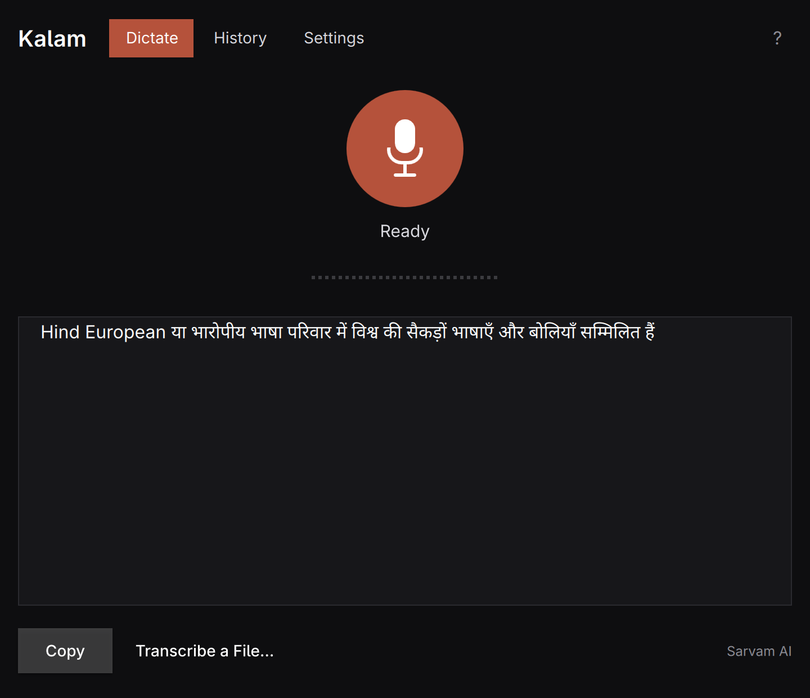

# Kalam for Linux



Speech-to-text dictation for Hindi + English (and code-mixed Hinglish), built for [Omarchy](https://omarchy.org) and Hyprland.
Press a key anywhere, speak, and the text lands at your cursor.

This is the Linux version of the macOS app in the repository root.
It is a separate Qt Quick program that keeps the same behaviour: the same engines, personal dictionary, history, and export formats.

> **Kalam for Linux has only been tested on Omarchy.**
> The dictation keys and the bar widget rely on Omarchy's own tooling (`omarchy dictation`, the Omarchy shell), and the package is an Arch package.
> See [Other distributions](#other-distributions) for what that means elsewhere.

## Engines

- **Sarvam AI** (default): the Saaras v3 cloud model, the most accurate option for Hindi and Hinglish.
  Add a free API key from [dashboard.sarvam.ai](https://dashboard.sarvam.ai) in Settings; it is stored in your keyring.
- **Local Whisper** (optional): fully offline through `whisper.cpp`.
  Install the `whisper-cpp` package and download a model in Settings.
  Nothing is downloaded unless you ask, and an installed model also serves as Sarvam's fallback when the network fails.

## Install

```sh
linux/bin/install                  # builds and installs the Arch package
omarchy-install-dictation-kalam    # starts the service and takes over the dictation keys
```

The second command enables `kalam.service`, makes Kalam the backend for `omarchy dictation` so Omarchy's own keys drive it, and adds Kalam's widget to the bar.
`omarchy-remove-dictation-kalam` undoes all three.

## Bar widget

A pen icon in the Omarchy bar (an Omarchy shell plugin, `omarchy-plugin/`) shows what Kalam is doing: it takes the bar's active colour while recording and becomes dots while transcribing.

| Click | Action |
| --- | --- |
| Left | Open the window (settings, history, API key) |
| Right | Start or stop dictating |
| Middle | Throw the recording away |

Drag it along the bar to move it; `omarchy plugin disable kalam.dictation` hides it.

## Shortcuts

| Key | Action |
| --- | --- |
| `Alt + Space` | Start or stop dictating, anywhere |
| `Alt + Right Alt` (hold) | Talk while held, anywhere |
| `Space` | Record in the window (the text stays in the window) |
| `Esc` | Throw the recording away |
| `C` | Copy the transcript |
| `O` | Transcribe an audio or video file (or drop one on the window) |
| `1` `2` `3` | Dictate, History, Settings |
| `/` | Search history |
| `↑` `↓` | Move through history |
| `Enter` | Copy the selected entry |
| `Delete` | Delete the selected entry |
| `Q` | Close the window (Kalam keeps listening) |
| `?` | Show every shortcut |

The two global keys belong to Omarchy; change them in its keybindings.

## Command line

```text
kalam                     show the window
kalam start|stop|toggle   dictate (stop pastes at the cursor)
kalam cancel              throw the current recording away
kalam transcribe <file>   print the transcript of an audio or video file
kalam status              what Kalam is doing
kalam quit                stop the background process
```

`transcribe` and `status` take `--json`.
`transcribe` needs no display, exits 1 with the reason on stderr when it fails, and uses the running Kalam when there is one.

## How it works

One `kalam` process runs per session (`kalam.service`).
The command line and Omarchy's dictation keys reach it over a socket in `$XDG_RUNTIME_DIR`.
While recording, a small pill at the bottom of the focused monitor shows the timer and your voice level.
When you stop, the transcript goes through your personal dictionary, onto the clipboard with `wl-copy`, and is pasted with `wtype` (`Ctrl+Shift+V` in terminals, `Ctrl+V` elsewhere).

Recordings end themselves after 2 minutes of silence or 10 minutes total; those are copied to the clipboard and saved to history but never pasted.

| What | Where |
| --- | --- |
| Settings | `~/.config/kalam/kalam.conf` |
| Personal dictionary | `~/.config/kalam/dictionary.json` |
| History | `~/.local/share/kalam/history.json` |
| Whisper models | `~/.local/share/kalam/models/` |
| Sarvam API key | the keyring (`secret-tool`, service `kalam`) |

## Other distributions

None of this has been tried, so treat it as a starting point rather than a supported path.

- The app itself needs Qt 6, `layer-shell-qt`, PipeWire, `wl-clipboard`, `wtype`, `ffmpeg`, and `secret-tool`, on a Wayland compositor that supports layer shell.
- Outside Omarchy there is no `omarchy dictation` to drive it: bind your own keys to `kalam toggle`, `kalam start`, and `kalam stop`, and start `kalam daemon` with your session.
- Pasting into terminals with `Ctrl+Shift+V` depends on Omarchy's window tags under Hyprland; elsewhere Kalam sends `Ctrl+V`, and the text is always on the clipboard.
- The bar widget is an Omarchy shell plugin and has no equivalent elsewhere.
- Away from Arch, build with `bin/build` and install `build/kalam` yourself; `bin/install` makes an Arch package.

## Develop

```sh
bin/build    # qmake6 + make into build/kalam
bin/test     # Qt Test, offscreen, against a fake Sarvam server
```

The interface follows the Omarchy theme accent, window rounding, and language (English and Hindi ship).

## Credits

The theme and translator classes and the portal file-picker pattern come from Omarchy's app templates and Omacut (MIT, David Heinemeier Hansson).
